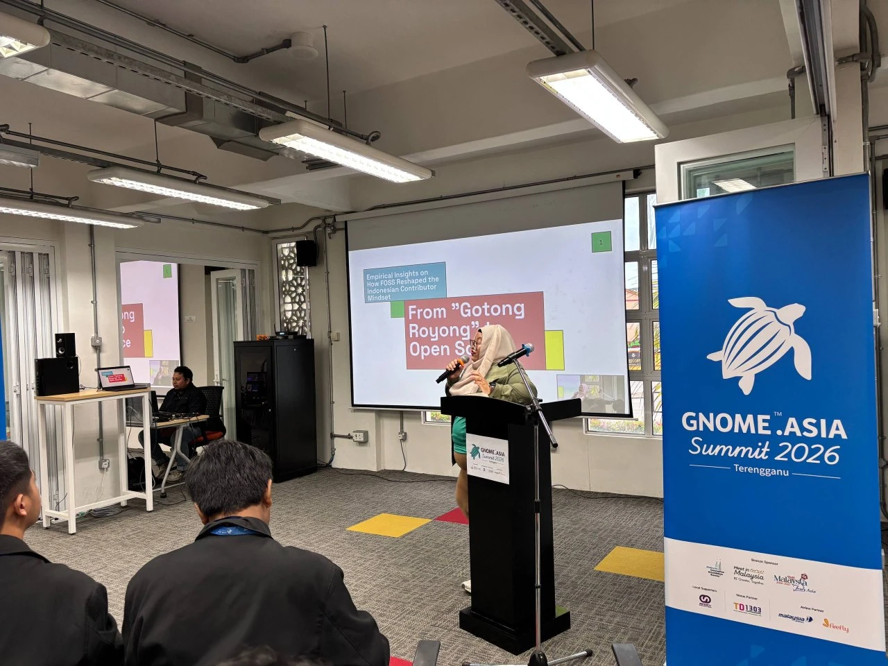
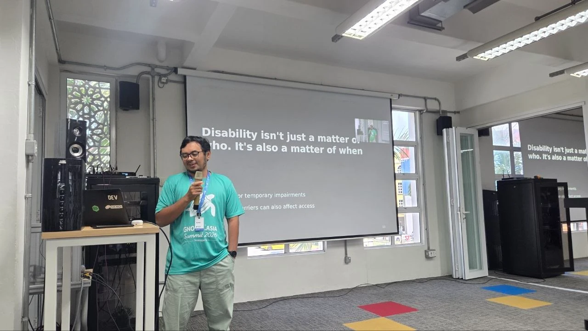
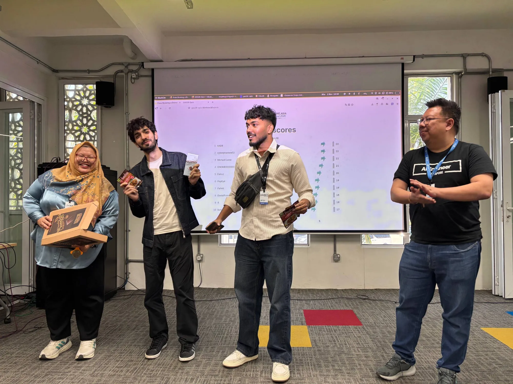

# BlankOn Foundation Participates in GNOME.Asia Summit 2026 in Malaysia

---

BlankOn Foundation participated in GNOME.Asia Summit 2026, held in Terengganu, Malaysia, from 31 October to 2 November 2026. The annual event brought together GNOME contributors, developers, and open source communities from across Asia to exchange knowledge, experiences, and ideas.

The Indonesian delegation brought together representatives from BlankOn Foundation and GNOME Indonesia, with Herpiko Dwi Aguno, Siska Iskandar, and Yudhi Satrio participating in the summit as speakers.

## Three Talks from Indonesia

Their presentations covered three different aspects of the open source ecosystem:

- **"From 'Gotong Royong' to Open Source: Empirical Insights on How FOSS Reshaped the Indonesian Contributor Mindset"** by Siska, exploring the relationship between Indonesian collaborative culture and open source contributions.
- **"From Reviving a Distro to Building an Open Source Movement: Lessons from GNOME"** by Herpiko, sharing BlankOn's revival journey and lessons on building sustainable open source communities and organizations.
- **"GNOME and its Accessibility Features"** by Yudhi, introducing accessibility capabilities within the GNOME desktop environment.

For BlankOn Foundation, the summit was an opportunity to share Indonesia's open source experiences while learning from the international GNOME community. In particular, GNOME's experience in community governance, contributor engagement, and organizational sustainability offers valuable insights for BlankOn Foundation as it continues developing its role in supporting Indonesia's open source ecosystem.

## A Quiz to Liven Things Up

To make the atmosphere more fun, Herpiko and Siska also ran a quiz session for the attendees. Participants competed for a spot on the leaderboard, and the top scorers took home prizes.

Beyond the presentations, the summit provided an opportunity to connect with contributors and community organizers from across Asia, exchange perspectives, and strengthen relationships within the wider open source community.

BlankOn Foundation would like to thank the GNOME Foundation and the GNOME.Asia Summit organizing team for bringing the community together. We look forward to continuing our engagement and collaboration with GNOME and other open source communities across the region.

Open source is not just about the software we build, but also about the communities we build around it.
