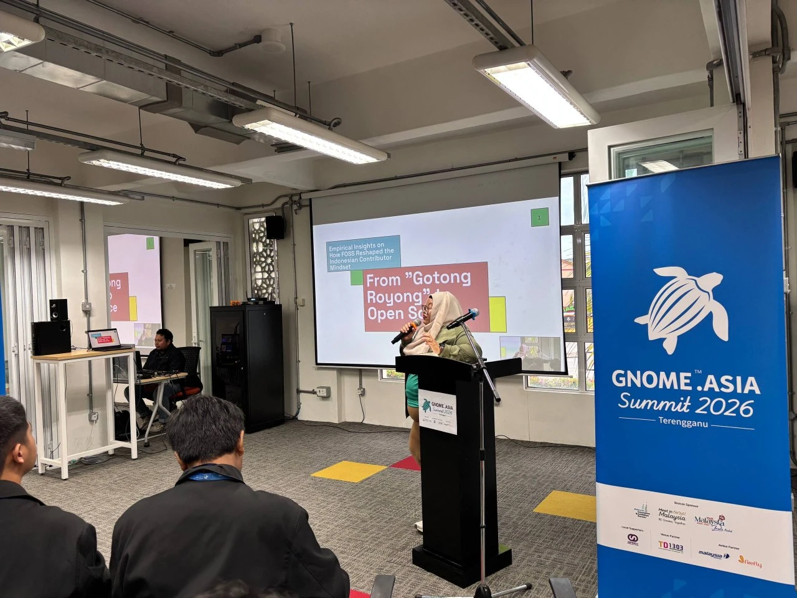
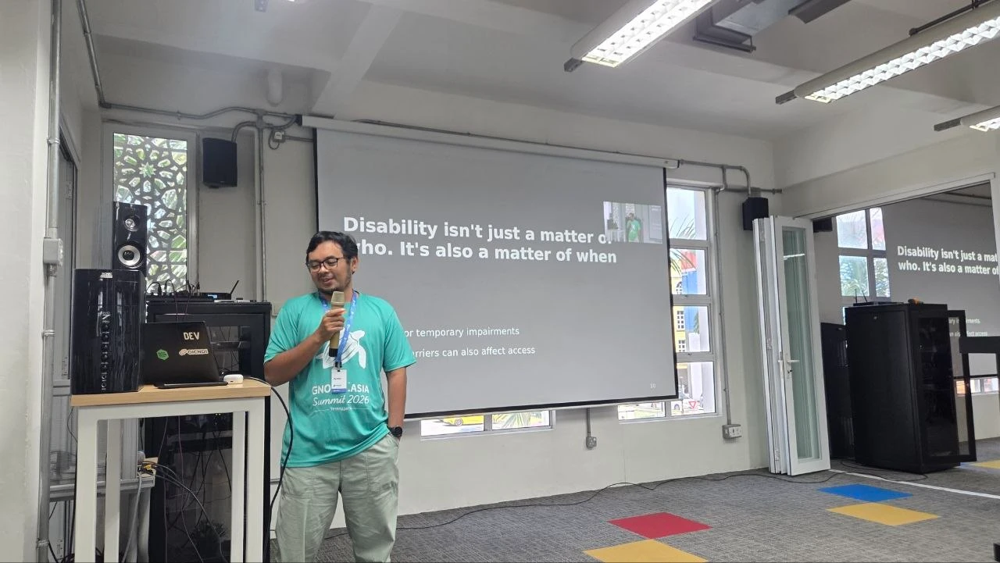
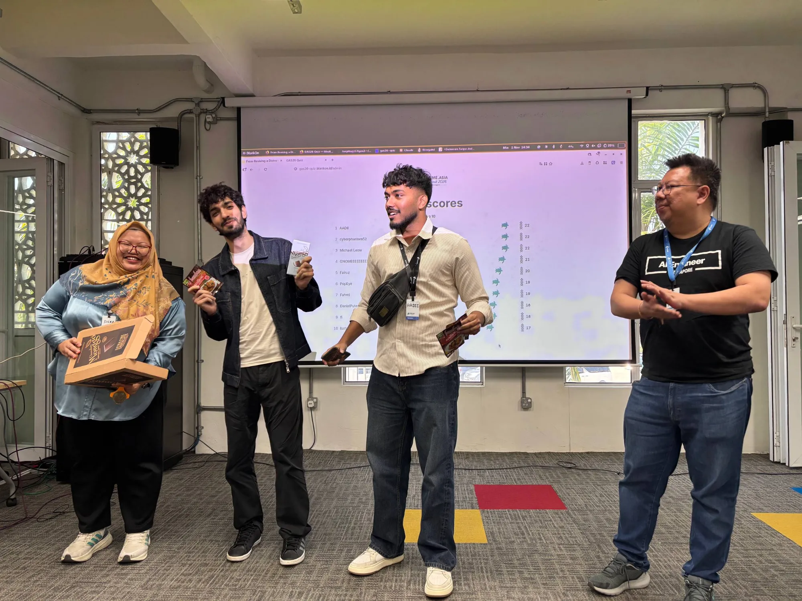

# BlankOn Foundation Berpartisipasi di GNOME.Asia Summit 2026 di Malaysia

---

BlankOn Foundation berpartisipasi dalam GNOME.Asia Summit 2026 yang diselenggarakan di Terengganu, Malaysia, pada 31 Oktober hingga 2 November 2026. Acara tahunan ini mempertemukan kontributor GNOME, pengembang, dan komunitas open source dari seluruh Asia untuk bertukar pengetahuan, pengalaman, dan gagasan.

Delegasi Indonesia terdiri dari perwakilan BlankOn Foundation dan GNOME Indonesia, dengan Herpiko Dwi Aguno, Siska Iskandar, dan Yudhi Satrio hadir sebagai pembicara.

## Tiga Presentasi dari Indonesia

Presentasi mereka membahas tiga aspek berbeda dari ekosistem open source:

- **"From 'Gotong Royong' to Open Source: Empirical Insights on How FOSS Reshaped the Indonesian Contributor Mindset"** oleh Siska, yang menelusuri hubungan antara budaya kolaboratif Indonesia dan kontribusi open source.
- **"From Reviving a Distro to Building an Open Source Movement: Lessons from GNOME"** oleh Herpiko, yang membagikan perjalanan kebangkitan kembali BlankOn serta pelajaran dalam membangun komunitas dan organisasi open source yang berkelanjutan.
- **"GNOME and its Accessibility Features"** oleh Yudhi, yang memperkenalkan berbagai fitur aksesibilitas di lingkungan desktop GNOME.

Bagi BlankOn Foundation, summit ini menjadi kesempatan untuk membagikan pengalaman open source Indonesia sekaligus belajar dari komunitas GNOME internasional. Secara khusus, pengalaman GNOME dalam tata kelola komunitas, pelibatan kontributor, dan keberlanjutan organisasi memberikan wawasan berharga bagi BlankOn Foundation dalam terus mengembangkan perannya mendukung ekosistem open source Indonesia.

## Kuis untuk Mencairkan Suasana

Agar suasana makin seru, Herpiko dan Siska juga mengadakan sesi kuis untuk para peserta. Peserta berlomba-lomba masuk papan skor, dan para peraih skor tertinggi membawa pulang hadiah.

Di luar sesi presentasi, summit ini juga membuka kesempatan untuk terhubung dengan para kontributor dan penggerak komunitas dari seluruh Asia, bertukar perspektif, dan mempererat hubungan dalam komunitas open source yang lebih luas.

BlankOn Foundation mengucapkan terima kasih kepada GNOME Foundation dan panitia GNOME.Asia Summit yang telah menyatukan komunitas. Kami menantikan keterlibatan dan kolaborasi yang berkelanjutan bersama GNOME dan komunitas open source lainnya di kawasan ini.

Open source bukan hanya tentang perangkat lunak yang kita bangun, tetapi juga tentang komunitas yang kita bangun di sekitarnya.
