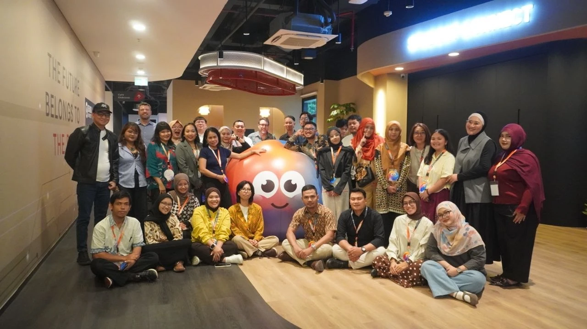
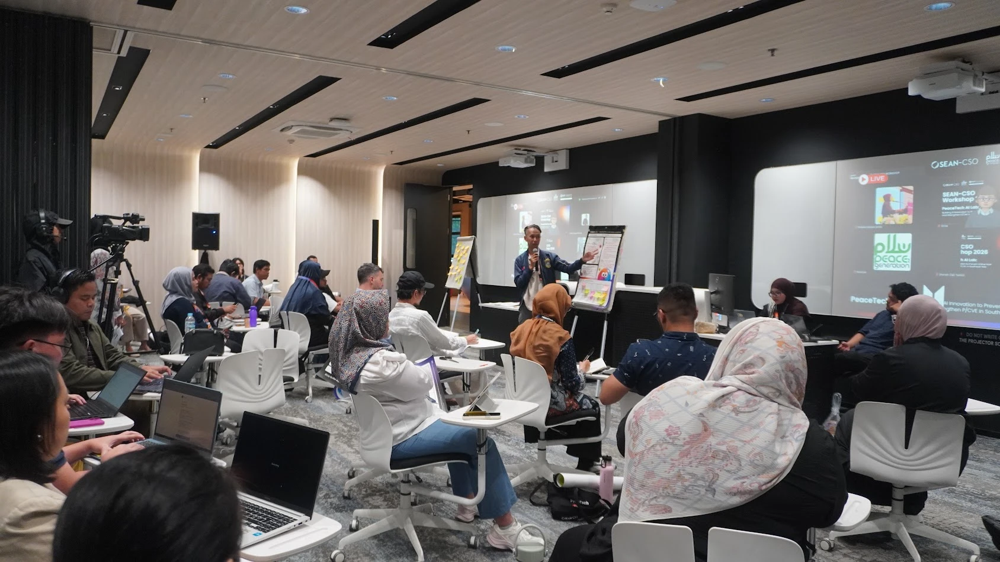
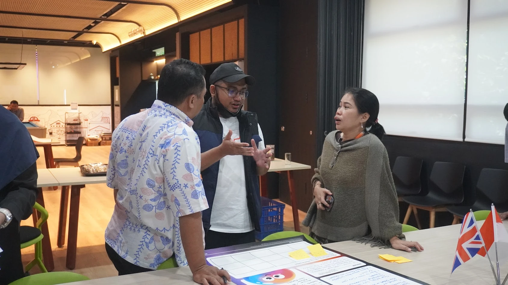

# BlankOn Foundation Joins SEAN-CSO PeaceTech AI Lab Workshop as Technical Mentors

---

BlankOn Foundation took part in the PeaceTech AI Lab Hybrid Workshop held by [SEAN-CSO](https://www.sean-cso.org/) together with Peace Generation Indonesia (PeaceGen) in Bandung, Indonesia, from 3 November until 6 November 2026. Carrying the theme "Building AI Innovation to Prevent Online Hate and Strengthen P/CVE in Southeast Asia", the workshop brought together civil society participants from across Southeast Asia, both in person in Bandung and online, to explore how artificial intelligence can be used responsibly to prevent and counter violent extremism (P/CVE).

BlankOn Foundation was represented by Siska Iskandar, Pahlevy Tawainella, and Sendy Aditya Suryana, who joined the workshop as technical mentors.

## From Webinars to Proofs of Concept

The workshop followed a series of webinars and gave participants space to move from learning and reflection toward designing concrete, AI-based ideas. Over four days, participants:

- Got to know each other in small "family groups" and revisited key findings from the webinar series through focus group discussions.
- Validated and sharpened the problems they wanted to solve, including their target users and the change they hoped to see.
- Turned their ideas into proofs of concept in a hackathon, then presented their ideas, AI applications, and prototypes to their peers for feedback.
- Refined their pitch decks and presented selected projects in a pitching and demo session, followed by an awarding session and a visit to Institut Teknologi Bandung (ITB) to learn about AI development and its ecosystem.

## The Role of Technical Mentors

Throughout the process, the mentors accompanied the participant groups. They listened to the initial ideas, asked critical questions to clarify each problem, gave advice on the technical side of the proposed solutions, and provided feedback on the decks and prototypes ahead of the final pitch. The mentoring drew on the Design for Change and System Change frameworks, with a strong emphasis on making sure every use of AI is relevant, feasible, ethical, and responsive to local context.

For BlankOn Foundation, this was a valuable opportunity to bring open source perspectives on technology, such as transparency, accountability, and community ownership, into conversations about responsible AI. It also opened new connections with civil society organizations working on digital safety and peacebuilding across the region.

BlankOn Foundation would like to thank SEAN-CSO and PeaceGen for the invitation and trust, and to congratulate all participants on the ideas and proofs of concept they developed during the workshop. We hope some of them will grow into solutions that make a real difference.
