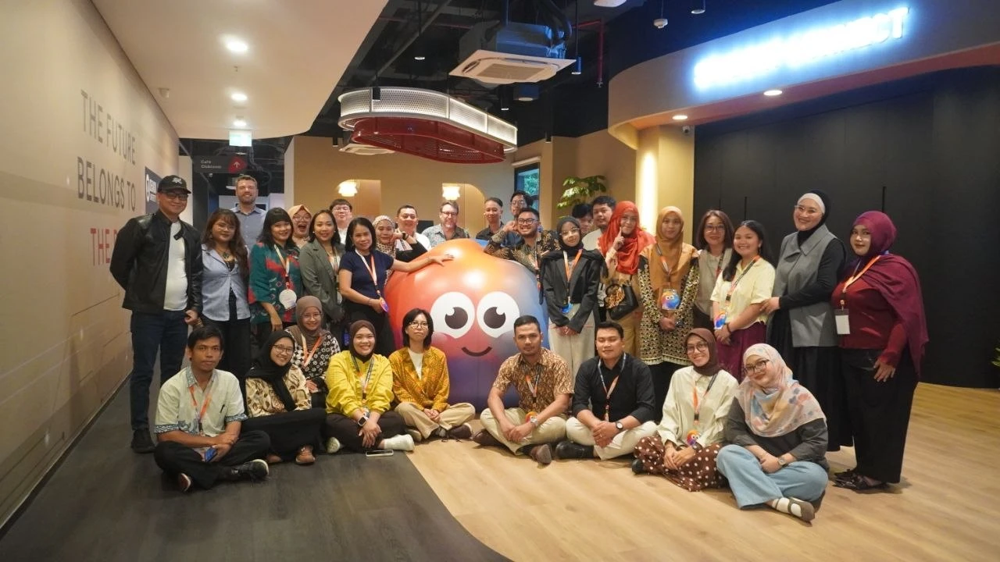
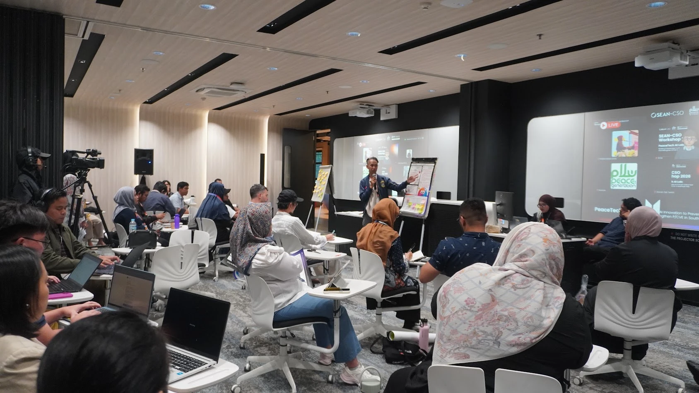
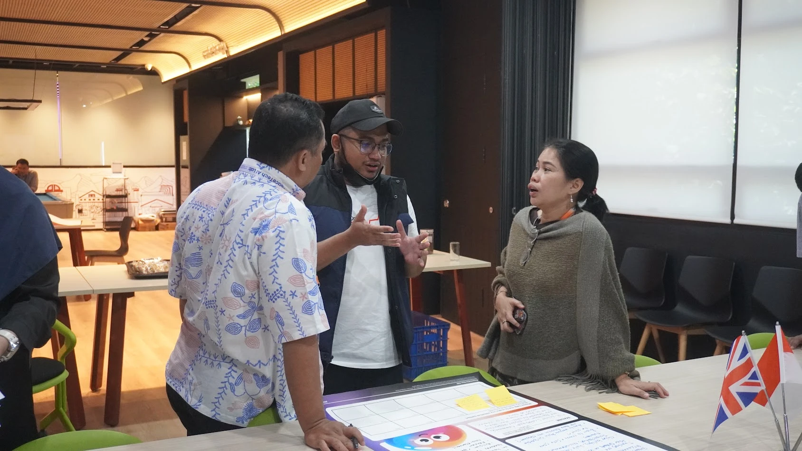

# BlankOn Foundation Menjadi Mentor Teknis di Lokakarya PeaceTech AI Lab SEAN-CSO

---

BlankOn Foundation turut serta dalam Lokakarya Hybrid PeaceTech AI Lab yang diselenggarakan oleh [SEAN-CSO](https://www.sean-cso.org/) bersama Peace Generation Indonesia (PeaceGen) di Bandung pada 3 November hingga 6 November 2026. Mengusung tema "Building AI Innovation to Prevent Online Hate and Strengthen P/CVE in Southeast Asia", lokakarya ini mempertemukan peserta dari organisasi masyarakat sipil di Asia Tenggara, baik secara langsung di Bandung maupun daring, untuk menggali bagaimana kecerdasan buatan dapat digunakan secara bertanggung jawab dalam upaya pencegahan dan penanggulangan ekstremisme kekerasan (P/CVE).

BlankOn Foundation diwakili oleh Siska Iskandar, Pahlevy Tawainella, dan Sendy Aditya Suryana, yang hadir sebagai mentor teknis.

## Dari Webinar ke Proof of Concept

Lokakarya ini merupakan kelanjutan dari rangkaian webinar dan memberi ruang bagi peserta untuk beranjak dari tahap belajar dan refleksi menuju perancangan gagasan berbasis AI yang konkret. Selama empat hari, peserta:

- Saling mengenal dalam "family group" dan meninjau kembali temuan kunci dari rangkaian webinar melalui diskusi kelompok terarah.
- Memvalidasi dan mempertajam masalah yang ingin mereka selesaikan, termasuk pengguna sasaran dan perubahan yang ingin dicapai.
- Mewujudkan gagasan mereka menjadi proof of concept dalam hackathon, lalu mempresentasikan ide, penerapan AI, dan prototipe mereka kepada sesama peserta untuk mendapatkan masukan.
- Menyempurnakan pitch deck dan menampilkan proyek terpilih dalam sesi pitching dan demo, dilanjutkan dengan sesi penghargaan dan kunjungan ke Institut Teknologi Bandung (ITB) untuk belajar tentang pengembangan AI dan ekosistemnya.

## Peran Mentor Teknis

Sepanjang proses tersebut, para mentor mendampingi kelompok peserta. Mereka menyimak ide awal, mengajukan pertanyaan kritis untuk memperjelas setiap masalah, memberi saran pada aspek teknis dari solusi yang diusulkan, serta memberikan masukan atas deck dan prototipe menjelang pitching akhir. Pendampingan ini mengacu pada kerangka Design for Change dan System Change, dengan penekanan agar setiap pemanfaatan AI relevan, layak dijalankan, etis, dan sesuai dengan konteks lokal.

Bagi BlankOn Foundation, ini menjadi kesempatan berharga untuk membawa perspektif open source tentang teknologi, seperti transparansi, akuntabilitas, dan kepemilikan bersama oleh komunitas, ke dalam percakapan tentang AI yang bertanggung jawab. Kegiatan ini juga membuka jejaring baru dengan organisasi masyarakat sipil yang bergerak di bidang keamanan digital dan bina damai di kawasan ini.

BlankOn Foundation mengucapkan terima kasih kepada SEAN-CSO dan PeaceGen atas undangan dan kepercayaannya, serta mengucapkan selamat kepada seluruh peserta atas gagasan dan proof of concept yang telah mereka kembangkan selama lokakarya. Kami berharap sebagian di antaranya dapat tumbuh menjadi solusi yang memberi dampak nyata.
